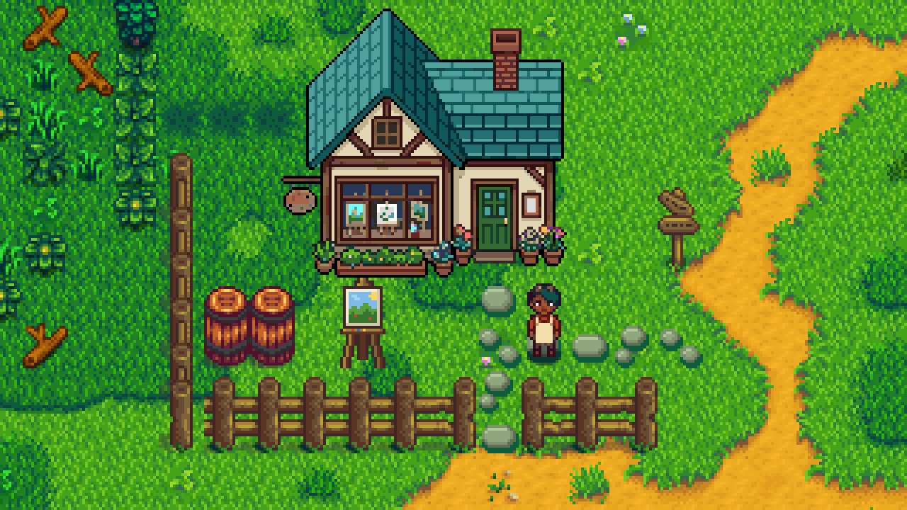

The **art supply shop** is in Cindersap Forest, west of the path down from Marnie's ranch. Sable runs it.

| | |
|---|---|
| **Hours** | 10am to 6pm |
| **Fridays** | until 5pm |
| **Sundays** | from 1pm |
| **Closed** | Wednesdays |

Married to Sable, you're never turned away: when they're out, the till runs on trust.

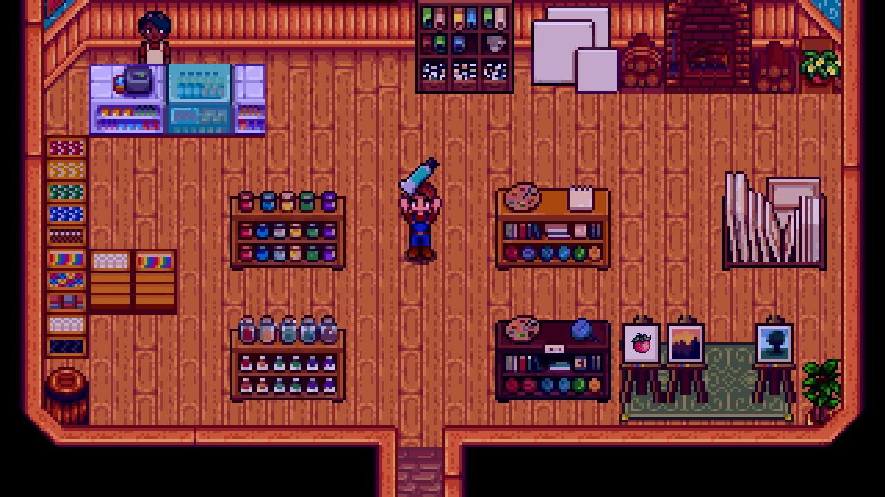

## The counter
Talk to the counter to:
- **Browse supplies (and sell paintings).** Sable pays 1.2x for paintings.
- **The commission board:** see [Commissions](Commissions).
- **Leave paintings with Sable to sell:** see [Consignment](Consignment).
- **Your painting record:** see [Painting Record](Painting-Record).

## Stock
| | Item | Price | Available |
|---|---|---|---|
|  | Easel | 300g | Always |
|  | Small Canvas | 25g | Always |
|  | Medium Canvas | 80g | Painting level 4 |
|  | Large Canvas | 200g | Painting level 7 |
|  | Linen Canvas (Medium) | 500g | Painting level 8 |
|  | Linen Canvas (Large) | 1,000g | Painting level 8 |
|  | Picture Frame | 150g | Always |
|  | Sienna Pigment | 120g | Until you know the colour |
|  | Rose Pigment | 120g | Until you know the colour |
|  | Marigold Pigment | 120g | Until you know the colour |
|  | Leaf Pigment | 120g | Until you know the colour |
|  | Peach Pigment | 120g | Until you know the colour |
|  | Snow Pigment | 200g | Once you know the colour |
|  | Plum Pigment | 200g | Once you know the colour |
|  | Cerulean Pigment | 200g | Once you know the colour |
|  | Iridium Violet Pigment | 1,500g | Once you know the colour |
|  | Palette | 150g | Always |
|  | Pigment Mill | 1,000g | Always |
|  | Varnish | 120g | Painting level 7 |
|  | Varnishing Cabinet | 3,000g | Painting level 7 |
| 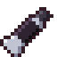 | Charcoal Paint | 8g | Once you know the colour |
| 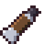 | Umber Paint | 8g | Once you know the colour |
| 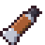 | Sienna Paint | 12g | Once you know the colour |
| 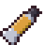 | Ochre Paint | 8g | Once you know the colour |
| 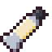 | Cream Paint | 8g | Once you know the colour |
| 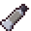 | Stone Paint | 8g | Once you know the colour |
| 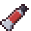 | Crimson Paint | 8g | Once you know the colour |
| 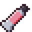 | Rose Paint | 12g | Once you know the colour |
| 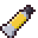 | Marigold Paint | 12g | Once you know the colour |
| 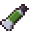 | Moss Paint | 8g | Once you know the colour |
| 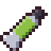 | Leaf Paint | 12g | Once you know the colour |
| 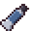 | Slate Paint | 8g | Once you know the colour |
| 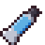 | Cerulean Paint | 20g | Once you know the colour |
| 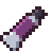 | Plum Paint | 20g | Once you know the colour |
| 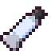 | Snow Paint | 20g | Once you know the colour |
| 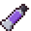 | Iridium Violet Paint | 60g | Once you know the colour |
| 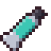 | Aquamarine Paint | 60g | Once you know the colour |
| 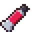 | Ruby Red Paint | 60g | Once you know the colour |
| 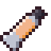 | Peach Paint | 12g | Once you know the colour |
|  | Flat Wash Brush | 400g | Painting level 2 |
|  | Sable Round Brush | 900g | Painting level 3 |
|  | Rigger Brush | 1,200g | Painting level 6 |
|  | Iridium Brush | 7,500g | Painting level 9 |
