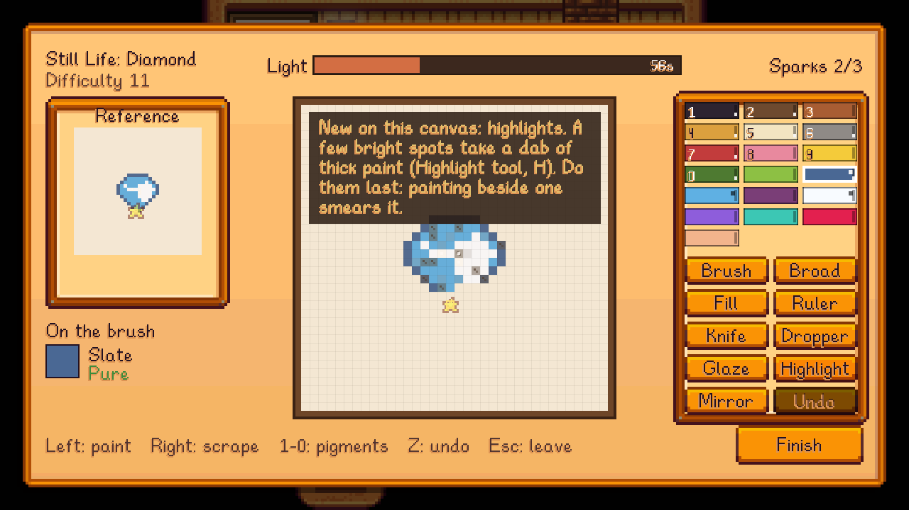

## Canvases
| | Canvas | Cells | Unlocks | Techniques | Recipe | Art shop |
|---|---|---|---|---|---|---|
|  | **Small Canvas** | 20x20 | Start | Flat colour |  Fiber (5)  Wood (2) | 25g |
|  | **Medium Canvas** | 28x28 | Level 4 | Glazing |  Cloth (1)  Wood (5) | 80g |
|  | **Large Canvas** | 36x36 | Level 7 | Glazing and highlights |  Cloth (2)  Hardwood (3) | 200g |
|  | **Linen Canvas (Medium)** | 28x28 | Level 8 | As medium, and Masterpieces |  Cloth (2)  Hardwood (2) | 500g |
|  | **Linen Canvas (Large)** | 36x36 | Level 8 | As large, and Masterpieces |  Cloth (3)  Hardwood (4) | 1,000g |

What goes on each size:
- **Small:** one item.
- **Medium:** up to two items, or a portrait (head and shoulders).
- **Large:** up to three items, or a whole portrait.

Every size can take a view, painted outdoors (see [Portraits and Plein Air](Portraits-and-Plein-Air)).

## Techniques
The painting grows with the canvas, one new idea at a time.

### Glazing (medium and large canvases)
Some cells of the reference are **glazed**: a thin, dark wash over a colour, like the shaded side of a pumpkin. To copy one:
1. Paint the cell its colour.
2. Go over it with the **Glaze** tool (T).

Glazing a bare cell does nothing, and painting over a glaze covers it. With the Glaze tool in hand, a dot marks every cell that wants a glaze. Glazes cost no paint.

### Highlights (large canvases)
A few of the brightest spots (the shine on a gem, the light in an eye) take a **highlight**: a dab of thick, light paint, put on with the **Highlight** tool (H).
- **Highlights go on last.** Painting a cell next to a highlight smears it away, and the easel warns you when that happens.
- As with glazes, dots show where highlights go, and they cost no paint.

### How techniques are scored
On a canvas with glazes or highlights, the results add a **Technique** rating: how many of them you put in the right places, and how few in the wrong ones (a cell out is forgiven). A painting with no techniques at all loses about a star. See [Quality and Masterpieces](Quality-and-Masterpieces).

**Relaxed** difficulty paints flat colour on every canvas.

## Linen
From Painting level 8, linen canvases (medium and large) paint like any other. They're the only canvas a **Masterpiece** can be painted on; see [Quality and Masterpieces](Quality-and-Masterpieces). On the setup screen, the **Linen** button next to the canvas sizes switches to linen.
