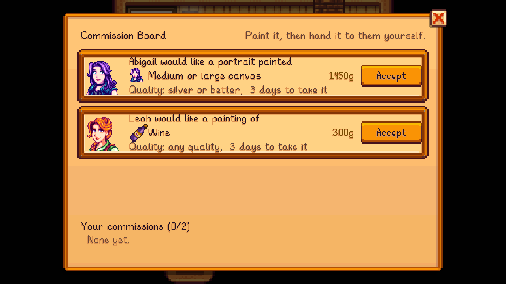

The **commission board** in the [Art Shop](Art-Shop) posts up to 3 requests at a time. Each one is from a villager, who wants a painting of something they love or like, at a minimum quality, for a reward.

## Taking a commission
1. Click **Accept** on a request. You can hold 2 at a time, and you have 7 days to deliver.
2. Paint it. On the setup screen, a gold ribbon marks the subject someone is waiting on.
3. Hand the painting to the villager, as you would a gift. It doesn't use up a gift for the week.

They pay the reward, and you gain 100 friendship points and Painting XP. If the painting isn't good enough, they tell you what quality they wanted.

## Portrait commissions
From medium canvases (Painting level 4), friends at 4 hearts or more sometimes ask for a **portrait of themselves**. Only friends who would sit for you ask. See [Portraits and Plein Air](Portraits-and-Plein-Air).

The **Patron's Favorite** profession makes commissions pay more.
