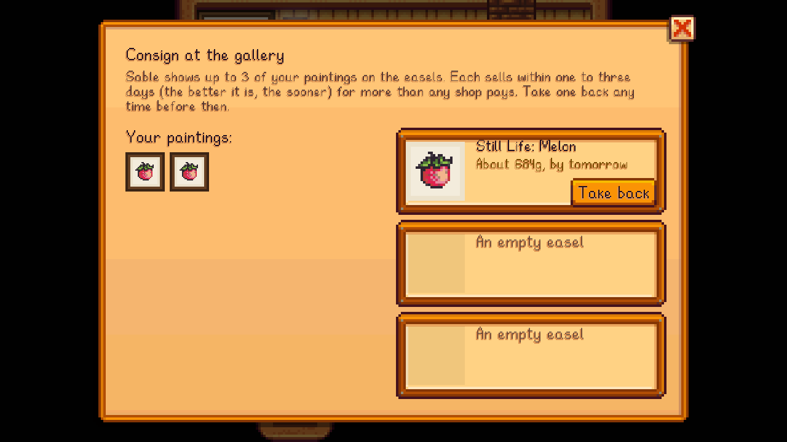

Leave up to **three paintings** with Sable at the art shop's counter (**Leave paintings with Sable to sell**).
- They go on the easels in Sable's corner of the shop, where you can see them.
- Each sells within one to three days, for **1.35x** its price: more than any shop pays.
  - Iridium paintings sell by the next morning.
  - Gold ones sell within two days.
  - Others take two or three.
- You can take a painting back any time before it sells.
- When one sells, the money arrives that morning, with a message and a little Painting XP.

Sable takes paintings in person: the counter has to be staffed (or you have to be married to Sable). In [Multiplayer](Multiplayer), each player has their own three easels.
