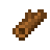
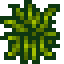
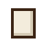
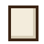
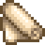
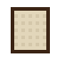
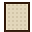
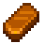
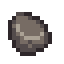
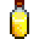

Recipes unlock with the Painting skill: you learn each one the morning after you reach its level.

| | Item | Ingredients | Unlocks |
|---|---|---|---|
|  | **Easel** |  Wood (30)  Fiber (10) | Known from the start |
|  | **Small Canvas** |  Fiber (5)  Wood (2) | Known from the start |
|  | **Medium Canvas** |  Cloth (1)  Wood (5) | Painting level 4 |
|  | **Large Canvas** |  Cloth (2)  Hardwood (3) | Painting level 7 |
|  | **Linen Canvas (Medium)** |  Cloth (2)  Hardwood (2) | Painting level 8 |
|  | **Linen Canvas (Large)** |  Cloth (3)  Hardwood (4) | Painting level 8 |
|  | **Picture Frame** |  Wood (10)  Copper Bar (1) | Painting level 2 |
|  | **Flat Wash Brush** |  Fiber (30)  Wood (5) | Painting level 2 |
|  | **Sable Round Brush** |  Rabbit's Foot (1)  Hardwood (1) | Painting level 3 |
|  | **Rigger Brush** |  Duck Feather (1)  Hardwood (1) | Painting level 6 |
|  | **Iridium Brush** |  Iridium Bar (1)  Rabbit's Foot (1) | Painting level 9 |
|  | **Palette** |  Wood (10) | Known from the start |
|  | **Pigment Mill** |  Stone (30)  Copper Bar (2)  Wood (10) | Painting level 1 |
|  | **Varnish** x2 |  Oak Resin (1)  Oil (1) | Painting level 7 |
|  | **Varnishing Cabinet** |  Hardwood (10)  Oak Resin (2)  Iron Bar (2) | Painting level 7 |
