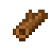
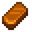
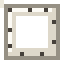
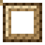

<table align="right"><tr><th colspan="2">Framer's Bench</th></tr><tr><td colspan="2" align="center"></td></tr><tr><td><b>Sell price</b></td><td>600g</td></tr><tr><td><b>Recipe</b></td><td>Painting level 4</td></tr><tr><td><b>Ingredients</b></td><td> Wood (20)  Hardwood (2)  Copper Bar (1)</td></tr><tr><td><b>Art shop</b></td><td>2,500g (Painting level 4)</td></tr></table>

Put a painting in a frame and it hangs on a wall as furniture: a small painting takes one tile (its picture fitted to the frame), a medium one 2x2 and a large one 3x3. On the easel's setup screen, **Frame a painting** shows every frame you have; pick one, then the painting. Hovering a frame shows its rarity and what it does.

## What a frame does
A framed painting hung in a room **inspires the easels in that room**: paintings made there get its frame's bonus. Build a studio.
- Each frame style has one **trait**. Its **rarity** sets how strong it is: a common frame gives one step of its trait, uncommon two, rare three, epic four, legendary six.
- **The three rarest** framed paintings in a room count, and their bonuses add up.
- **At an easel you've placed**, the setup screen shows an icon for each bonus the room gives. Hover one to see how much.

| Trait | Each step |
|---|---|
| Light | +2% light |
| Night | +4% light, from 7pm |
| Sparks | Inspiration sparks come 5% sooner |
| Thrift | A 1.5% chance a cell's paint isn't used |
| Learning | +3% Painting XP |
| Value | Paintings made there are worth 2% more |

## Frame styles
| | Frame | Rarity | One hung | From |
|---|---|---|---|---|
|  | **Picture Frame** | Common | Paintings made there worth 2% more | Crafted; the art shop |
|  | **Pine Frame** | Common | A 1.5% chance a cell's paint isn't used | The art shop |
|  | **Oak Frame** | Common | +3% Painting XP | The art shop |
|  | **Birch Frame** | Common | Inspiration 5% sooner | The art shop |
|  | **White Frame** | Common | +2% light | The art shop |
|  | **Walnut Frame** | Uncommon | +6% Painting XP | The art shop, from Painting level 3 |
|  | **Red Lacquer Frame** | Uncommon | Paintings made there worth 4% more | The art shop, from Painting level 5 |
|  | **Rope Frame** | Uncommon | A 3% chance a cell's paint isn't used | The art shop, from Painting level 7 |
|  | **Moonlit Frame** | Rare | +12% light after 7pm | Sable's Night Market stall ([Festivals](Festivals)) |
|  | **Driftwood Frame** | Rare | Inspiration 15% sooner | The museum: the Wreck set |
|  | **Iron Frame** | Rare | +9% Painting XP | The museum: the Miners set |
|  | **Sandstone Frame** | Rare | +6% light | The museum: the Calico set |
|  | **Gold-Leaf Frame** | Epic | Paintings made there worth 8% more | The finished portfolio ([Portfolio and Back Room](Portfolio-and-Back-Room)) |
|  | **Dwarvish Frame** | Epic | A 6% chance a cell's paint isn't used | The museum: the Dwarvish set |
|  | **Prismatic Frame** | Legendary | Inspiration 30% sooner | Qi's gem shop (25 Qi Gems) |
|  | **Qi's Frame** | Legendary | Paintings made there worth 12% more | Qi's special order ([Special Orders](Special-Orders)) |

## The Framer's Bench
Takes a painting out of its frame, so frames can be collected and swapped.
1. Place the bench and use it while holding a framed painting.
2. The next morning, take out the painting, just as it was, and its empty frame.

A recipe at Painting level 4, or from the art shop. It works with Automate.
