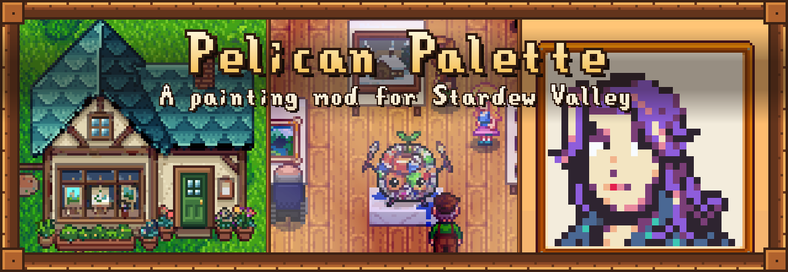

**Pelican Palette** is a mod for Stardew Valley that adds painting:
- a minigame as hands-on as fishing,
- a Painting skill,
- an art supply shop in Cindersap Forest,
- Sable, the former museum restorer who runs it.

This wiki covers every item, recipe, price and mechanic. It's written for version 1.1.2.

## Start here
- [Getting Started](Getting-Started): your first easel, canvas and painting
- [Painting](Painting): how the minigame works
- [Sable](Sable): the art shop's owner, and a marriage candidate

## Painting
| | |
|---|---|
| [Painting](Painting) | The easel, mixing, light, sparks and tools |
| [Canvases and Techniques](Canvases-and-Techniques) | Canvas sizes, glazing, highlights and linen |
| [Quality and Masterpieces](Quality-and-Masterpieces) | How a painting's quality is decided |
| [Pigments and Paint](Pigments-and-Paint) | Every colour, how to learn it, and how to get paint |
| [Brushes](Brushes) | The five brushes and what they change |
| [Portraits and Plein Air](Portraits-and-Plein-Air) | Painting friends and painting the view |
| [Painting Skill](Painting-Skill) | Levels, unlocks and professions |

## Paintings
| | |
|---|---|
| [Selling and Prices](Selling-and-Prices) | Where to sell, and what a painting is worth |
| [Commissions](Commissions) | Villagers' requests on the art shop's board |
| [Consignment](Consignment) | Selling through Sable's gallery |
| [Painting Record](Painting-Record) | Every subject you've painted, and its milestones |
| [Varnishing](Varnishing) | Curing paintings in a Varnishing Cabinet |
| [Gifting Paintings](Gifting-Paintings) | Who likes what |

## The shop and the rest
| | |
|---|---|
| [Art Shop](Art-Shop) | Location, hours and stock |
| [Crafting](Crafting) | Every recipe |
| [Sable](Sable) | Schedule, gifts, heart events and marriage |
| [Multiplayer](Multiplayer) | Playing in co-op |
| [Configuration](Configuration) | The settings |
| [Compatibility](Compatibility) | Other mods |
| [FAQ](FAQ) | Common questions |
| [Translating](Translating) | Adding a language |
| [Changelog](Changelog) | Version history |
