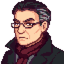

<table align="right"><tr><th colspan="2">Julian Vane</th></tr><tr><td colspan="2" align="center"></td></tr><tr><td><b>Pronouns</b></td><td>he/him</td></tr><tr><td><b>Visits</b></td><td>The 22nd to the 24th of every season</td></tr><tr><td><b>Lives in</b></td><td>Zuzu City</td></tr><tr><td><b>Marriage</b></td><td>No</td></tr></table>

**Julian Vane** is an art critic from Zuzu City, at *The Zuzu Review*. Ten years ago he reviewed Sable's first show in one sentence everyone still quotes. Now he's visiting the valley.

 

## Visits
Julian is in the valley on the **22nd, 23rd and 24th** of every season. He gets off the morning bus at 10am and leaves on the evening one, once he's walked back to the bus stop after 6pm. His friendship doesn't fade while he's away.

| Day | 10am | 1pm | 4pm | 6pm |
|---|---|---|---|---|
| 22nd | The art shop's back room, looking through your portfolio | The museum | The Saloon | The bus stop, then gone |
| 23rd | The beach | The museum | The Saloon | The bus stop, then gone |
| 24th | The art shop's back room | Cindersap Forest, by the river where Sable paints (from 1:30pm) | The Saloon | The bus stop, then gone |

The times are when he sets off, so give him a little while to walk there. He's at the Stardew Valley Fair too, on the 16th of fall (see [Festivals](Festivals)).

## Gifts
- **Loves:** wine, truffle oil, prismatic shards, and fine paintings
- **Likes:** cheese and preserves
- **Hates:** Joja Cola, slime and seaweed

## Heart events
Five heart events, at 2, 4, 6, 8 and 10 hearts, tell his story with Sable. Along the way there's an Old Catalogue to deliver, and at the end a framed review to hang.

Spoilers: when and where each event happens

| Hearts | Where and when |
|---|---|
| 2 | The shop's back room, a visit morning, once your portfolio holds three paintings |
| 4 | The museum, a visit afternoon |
| 6 | The bus stop, the evening of the 24th, after Sable's 6-heart event |
| 8 | The Saloon, a visit evening |
| 10 | The art shop, a visit evening, after Sable's 8-heart event and once Sable has the catalogue |

## The Fair
Julian judges the painting contest at the Stardew Valley Fair. See [Festivals](Festivals).
