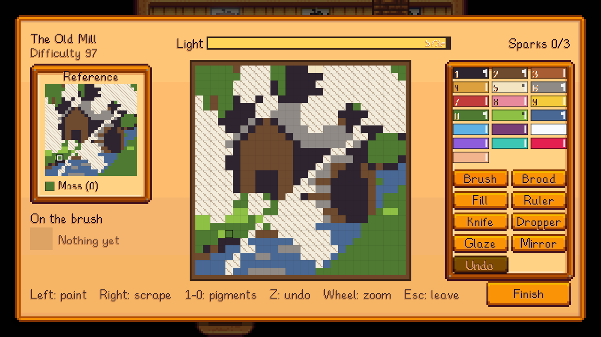

Damaged old paintings turn up around the valley: twenty-one of them, in five sets. Each is flaked, torn or water-stained over about a third of it. Restored, they're worth far more than your own paintings, and the museum wants them.

## Finding them
| Set | Where | Paintings | Canvas | Restored value |
|---|---|---|---|---|
| **the Old Valley** | Artifact spots (1.5% a dig) | The Town Square, A Farm at Evening, The Old Mill, A Young Man in Green, The Harvest | 28x28 | 1,500g |
| **the Wreck** | Fishing treasure chests (4% a chest) | A Ship's Portrait, The Storm, The Harbour at Dawn, The Captain, The Lighthouse | 28x28 | 2,000g |
| **the Miners** | Crates and barrels in the mines (0.4% to 0.8%, more deeper down) | The Mining Town, A Miner's Family, Sunday on the Hill, The Mine Mouth, The Crystal Cave | 28x28 | 2,000g |
| **Calico** | Skull Cavern crates (1%), treasure rooms (10%) | The City by the Oasis, The Market, The Queen of Calico, The Caravan | 36x36 | 4,000g |
| **the Dwarves** | Volcano Dungeon chests (8%) | The Forge, The Dwarf King | 36x36 | 6,000g |

- **Your first is guaranteed:** the first fishing treasure chest or artifact spot after you reach Painting level 3.
- **The Travelling Cart** sometimes sells one from any set (about one day in six), for 3,000g.
- **Margot's loupe**, from the museum's collection, makes every way of finding one half as likely again. See [The Museum](The-Museum).
- **Which one you get:** each find is a painting from its set that the museum hasn't got yet and that isn't already in your bag.

Take your first to **Gunther** at the museum: he writes to the city, and [Margot Pell](Margot-Pell) arrives a week after his letter.

**Lost one?** Nothing's lost for good. If you lose your first before Gunther has seen it (trashed, left in a chest, dropped in the mines), the next artifact spot or fishing chest brings another. After that, a painting you've lost or sold comes back as readily as one you've never found, until the museum has it. A restoration of any quality can be donated.

## Getting one restored
Until you're a conservator, **Margot** restores them for a fee: hold the damaged painting and talk to her at the museum. Three days later it comes back in the post, attached to her letter, at silver quality. See [Margot Pell](Margot-Pell) for her fees.

## Painting Mastery
Past Painting level 10, your Painting XP keeps counting towards **Painting Mastery**: a bar of 15,000 XP, shown in the Painting skill's tooltip.

The morning after you reach level 10, she writes to you with her old **Study Board** (if you haven't met her yet, it comes the morning after you first talk to her). Hang it on a wall: it fills with pinned studies a quarter at a time as the bar does, and is full when she's ready to test you. Right-click it (or hover it in your bag) for the exact numbers. If you lose it, Margot posts you another (at most once a week). Margot notices each quarter too, the next time you talk to her.

When the board is full, talk to Margot at the museum: she offers the test on your first word, before anything else she has to say. Say you're ready and she asks which mode you'd like to paint it in (Simplified, Relaxed, Normal or Hard; it's saved, like the easel's mode button). Then she sets you a **test restoration** at her table.
- **Gold or better** and she certifies you a conservator, with the game's mastery sparkle. You get the **Master's Easel**, an easel with 15% more light. A medium or large painting made at it at gold or better is a **living masterwork**: hung on a wall, it moves a little. A scene (a view painted outdoors, a restored old painting or an original) comes alive in its colours: glints drift across its water (slate, cerulean, aquamarine), firelight breathes in its reds and golds (crimson, ruby, marigold) and a breeze passes over its leaves (moss, leaf). Anything else (a still life, a portrait, an animal or a creature) catches a soft band of window light drifting across it now and then.
- **Below gold**, try again the next day.

The painting is **Zuzu at Dusk**, the Zuzu City Museum of Art's own, lent to her for testing conservators. It isn't one of the valley's 21: it goes back to the city either way, and isn't part of your collection.

## Restoring one yourself
Once you're a conservator, a damaged painting in your bag shows a **Restore** slot on any easel's setup screen.
- **The canvas** starts as the damaged painting, with the surviving paint already there. It's its own canvas, so none is used.
- **The reference** shows the painting as it was, whole. The canvas starts with what's left of it, and the missing cells are hatched, so bare canvas can't be mistaken for pale paint. Point at a gap to see its colour on the reference.
- **Scoring:** only the damaged cells count. The right colour counts fully, a near one half, and mixing purity counts as usual. Painting over surviving paint with a different colour costs you.
- **The light** is set from what's missing (the cells you have to paint), with a little more for matching each gap to the picture.
- **The result:** the painting, titled as it was ("The Old Mill"), at the quality you earned, restored by you.

## What a restored painting is worth
| Quality | Value |
|---|---|
| Normal | The set's value (above) |
| Silver | 1.25x |
| Gold | 1.5x |
| Iridium | 2x |

Sell it, keep it, frame it, or give it to the museum ([The Museum](The-Museum)).
