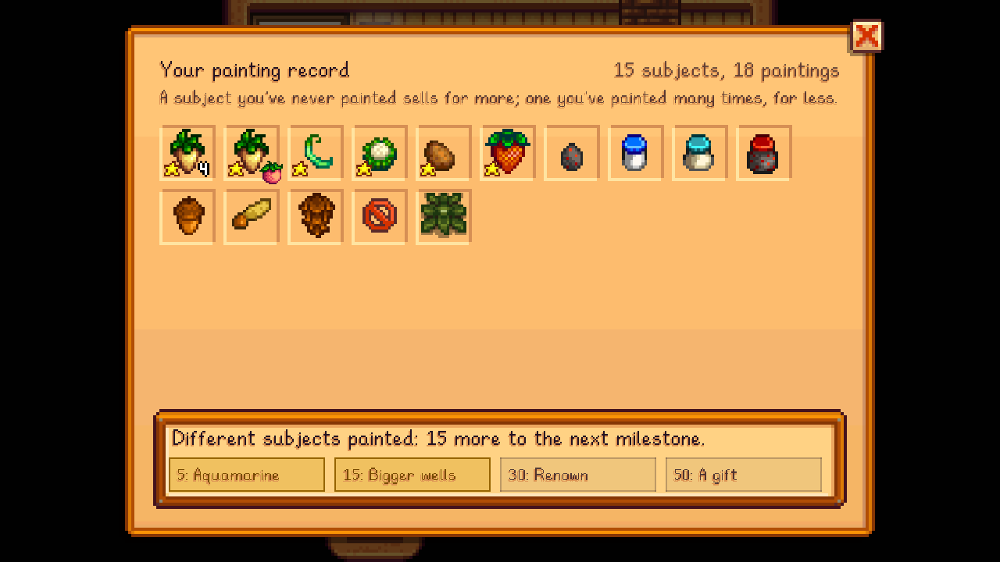

Every subject you paint goes in your **painting record**: how many times you've painted it, your best quality, and when you first painted it. Open it at the art shop's counter (**Your painting record**).

**What counts as a subject:**
- each item, or each set of items in a still life (in any order),
- each friend's portrait,
- each place's view in each season.

Free canvases don't count.

## Novelty
A subject's first painting ever sells for more. Painting the same subject again and again in one week sells for less, and the count starts over every Monday; see [Selling and Prices](Selling-and-Prices).

## Milestones
| Different subjects | Reward |
|---|---|
| 5 | Three tubes of Aquamarine paint (and the colour) |
| 15 | Every Palette's wells hold half as much again |
| 30 | Every painting you make is worth 1.1x |
| 50 | A letter from Sable, with an Iridium Brush |
