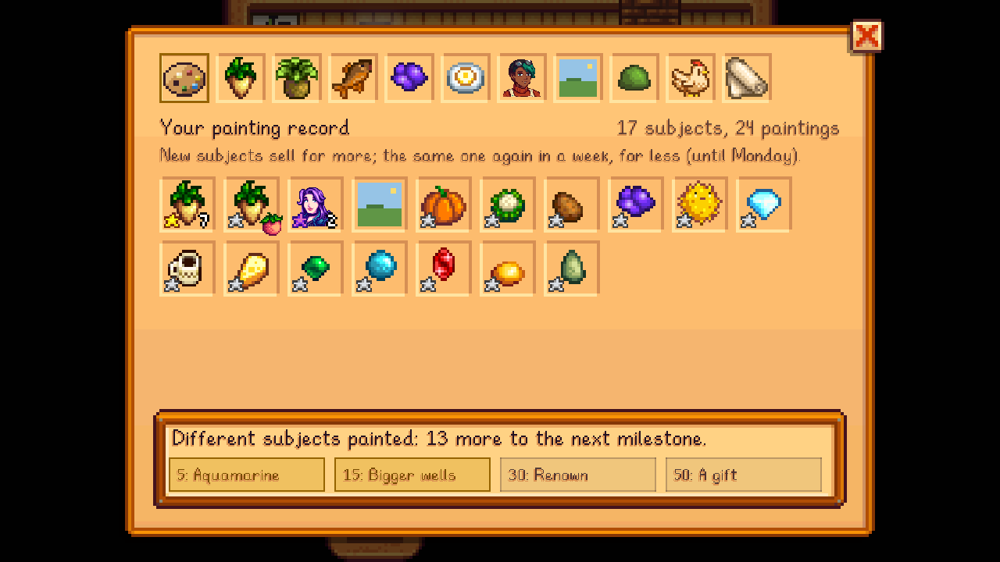

Every subject you paint goes in your **painting record**: how many times you've painted it, your best quality, and when you first painted it. Open it at the art shop's counter (**Your painting record**).

**What counts as a subject:**
- each item, or each set of items in a still life (in any order),
- each friend's portrait,
- each place's view in each season.

Free canvases don't count.

## Tabs
The record opens on an **overview** of everything you've painted, with the milestones below. The tabs along the top sort it like the game's Collections tab:

| Tab | Holds |
|---|---|
| Crops | Everything grown from seeds or fruit trees |
| Forage | Wild produce: greens, berries, mushrooms |
| Fish | Everything in the fishing collection |
| Minerals | Gems and minerals |
| Cooking | Every dish |
| Portraits | Everyone who can sit for a portrait |
| Views | Every outdoor place you can set up an easel |
| Creatures | Every monster you've slain, and the Junimos |
| Everything else | Artisan goods, animal products and the rest (only what you've painted) |

- **Still to paint:** what you haven't painted yet shows faded. Hover over it to see how to paint it. Something you've never had shows as "???".
- **Still lifes of several items** count for each item in them.
- **Views** count for their place in any season. Small squares on the tile show the seasons you've painted it in.
- **Your own painting:** a subject you keep a painting of, in the portfolio or the plan chest, shows that painting on its tile ([Portfolio and Back Room](Portfolio-and-Back-Room)).

## Tab rewards
Every tab except "everything else" rewards you for painting a share of it:

| Painted | Reward |
|---|---|
| 25% | Three tubes of the tab's colour (and the colour) |
| 50% | Two Picture Frames |
| 100% | Every painting from that tab sells for 1.1x |

The colours: Leaf (crops), Moss (forage), Cerulean (fish), Iridium Violet (minerals), Crimson (cooking), Peach (portraits) and Slate (views). Rewards come after the painting that reaches them, so a record from before the tabs catches up with the next painting you make.

## Novelty
A subject's first painting ever sells for more. Painting the same subject again and again in one week sells for less, and the count starts over every Monday; see [Selling and Prices](Selling-and-Prices).

## Milestones
| Different subjects | Reward |
|---|---|
| 5 | Three tubes of Aquamarine paint (and the colour) |
| 15 | Every Palette's wells hold half as much again |
| 30 | Every painting you make is worth 1.1x |
| 50 | A letter from Sable, with an Iridium Brush |
