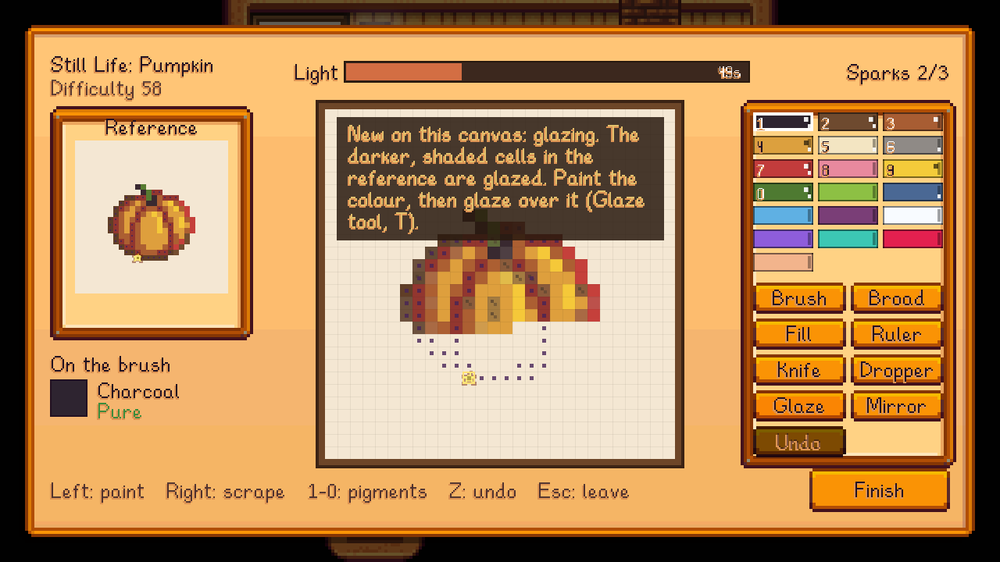

Right-click a placed **Easel** to paint. A session has three screens: **Setup**, **Painting** and **Results**.

## Setup
- **Canvas:** choose small, medium or large. Bigger canvases unlock with the [Painting Skill](Painting-Skill); see [Canvases and Techniques](Canvases-and-Techniques).
- **Subject:** choose what to paint:
  - one to three items from your bag (a still life),
  - a friend who will sit for a portrait,
  - the view, at an easel outdoors ([Portraits and Plein Air](Portraits-and-Plein-Air)),
  - or a **Free canvas**, with no reference and no score.
- **Preview:** shows the reference exactly as you'll copy it, with its **difficulty** (0-100) and how long the light lasts.
- **Brush:** cycles through the [Brushes](Brushes) in your bag.
- **Frame a painting:** puts one of your paintings in a Picture Frame, to hang as furniture.
- **Warnings:** under Begin, the screen tells you if you're out of canvases, if it's too late in the day (a painting can't run past 2am), or if your Palette is low on a colour the subject needs.

## Painting
The reference is pinned on the left; your canvas is in the middle; the palette and tools are on the right.

**Mixing.** Click a colour on the palette and a mixing bar opens, like fishing.
- The true colour drifts up and down the bar. Hold the mouse button to lift your mix, and let go to let it fall.
- Keep it on the true colour until the meter fills.
- A clean mix paints **pure** colour. A shaky one comes out **a bit off**, and a bad one **muddy** (visibly grimy, and worth less).
- Each colour moves in its own way: earth colours drift smoothly, minerals dart, and rare pigments are the hardest. See [Pigments and Paint](Pigments-and-Paint).

**Painting.** Left-click or drag to paint with what's on the brush. A load covers a number of cells, set by your brush and level. Right-click scrapes paint off.

**The light.** A bar at the top runs down while you work.
- When it's gone, the painting is finished as it stands.
- Finish early and the light that's left becomes bonus experience.
- The light pauses while you mix, except on Hard.

**Inspiration sparks.** Every so often a spark appears on a cell of the canvas: a gold ring round it, the cell glowing in the colour it wants. The same cell is ringed on the reference, its colour left in view.
- Paint that cell its right colour, mixed pure, before the spark fades.
- Each spark you catch adds light.
- Catch three and the painting is **Inspired**, which raises its quality.
- Very rarely, a spark teaches you a rare pigment.

**Paint.** Every cell you paint uses one cell of paint from your Palette (except on Relaxed). See [Pigments and Paint](Pigments-and-Paint).

**Finding your place.** Point at a cell of the canvas and the same cell is framed on the reference, and the other way round, so you always know which cell you're on.

**The mode.** Under **Begin** on the setup screen, click the mode ("Normal mode, 1h of your day") to switch between Relaxed, Normal and Hard; hover it to see what each changes. **Relaxed** has no time limit at all. The choice is saved, and is the same setting as in the config.

### Tools
| Tool | Key | Unlocks | What it does |
|---|---|---|---|
| Brush | B | Start | Paints one cell |
| Broad brush | G | Level 2 | Paints a 2x2 block |
| Fill | F | Start | Fills an area of one colour |
| Ruler | L | Level 3 | Drag out a straight line |
| Knife | K | Start | Scrapes paint off (right-click does too) |
| Dropper | D | Level 6 | Click a cell to mix its colour |
| Mirror | M | Level 4 | Repeats strokes across the middle |
| Glaze | T | Medium canvases | A dark wash over paint ([Canvases and Techniques](Canvases-and-Techniques)) |
| Highlight | H | Large canvases | A dab of thick, light paint ([Canvases and Techniques](Canvases-and-Techniques)) |
| Undo | Z | Start | Undoes the last stroke (paint isn't refunded) |

Number keys 1-0 pick your first ten colours.

## Results

The results screen shows:
- **Stars**, from how well you copied the reference.
- **Shape, Color, Neatness and (on medium and large canvases) Technique**, each rated Poor to Excellent.
- **Mixing**: how pure your paint was. **Sparks** caught, and the **light** left.
- The painting's **quality** and price, and the Painting XP you earned.
- A **critique**. From 2 hearts with Sable, the critique is theirs.

See [Quality and Masterpieces](Quality-and-Masterpieces) for how the quality is worked out.

## Painting takes time
Painting uses part of your day. When you step away from the easel, the clock moves on:

| Canvas | Still life | Portrait or view |
|---|---|---|
| Small | 1 hour | 2 hours |
| Medium | 2 hours | 3 hours |
| Large | 3 hours | 4 hours |

In multiplayer, where the clock is shared, painting doesn't move it.
