Painting has two resources: the **colours you know** and the **paint you have**.

## Colours are knowledge
You know a colour the way you know a recipe, and you never lose one. You start with the eight starter colours. There are four ways to learn more:
- **Buy its pigment** from Sable. The jar teaches you the colour the moment it reaches your bag.
- **Pick up a tube** of a colour you don't know: the first one teaches it.
- **Mill it** in a Pigment Mill (below).
- **Inspiration sparks** very rarely teach a rare colour.

The more colours you know, the closer your references get to the real thing. That makes them harder, and worth more.

## Paint is what you spend
- **The Palette.** It holds paint for each colour, in tubes' worth (a tube is 100 cells). A new Palette comes with the starter colours.
- **Spending.** Every cell you paint uses one cell of paint. The setup screen warns you if you're short of a colour.
- **Tubes go straight in.** When a tube reaches your bag, bought, milled or picked up, it goes into your Palette at once, if you know the colour and there's room for the whole tube. Anything that doesn't fit stays in your bag.
- **Relaxed** difficulty paints for free and needs no Palette.

## Palettes
| | Palette | Each colour holds | Recipe | Unlocks | Art shop |
|---|---|---|---|---|---|
|  | **Wooden Palette** | 3 tubes (300 cells) |  Wood (10) | Known from the start | 150g |
|  | **Enamel Palette** | 6 tubes (600 cells) |  Refined Quartz (1) 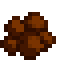 Clay (5)  Copper Bar (2) | Painting level 5 | 2,500g |
|  | **Iridium Palette** | 10 tubes (1000 cells) |  Iridium Bar (2)  Refined Quartz (2) | Painting level 9 | 12,000g |

- **Which Palette you paint from:** the easel uses the biggest Palette in your bag, and tubes go into that one too.
- **Bigger wells:** once your [Painting Record](Painting-Record) reaches 15 subjects, every Palette holds half as much again.

- **Not a gift:** like a tool, a Palette can't be given to a villager by accident.

### A Palette on the floor
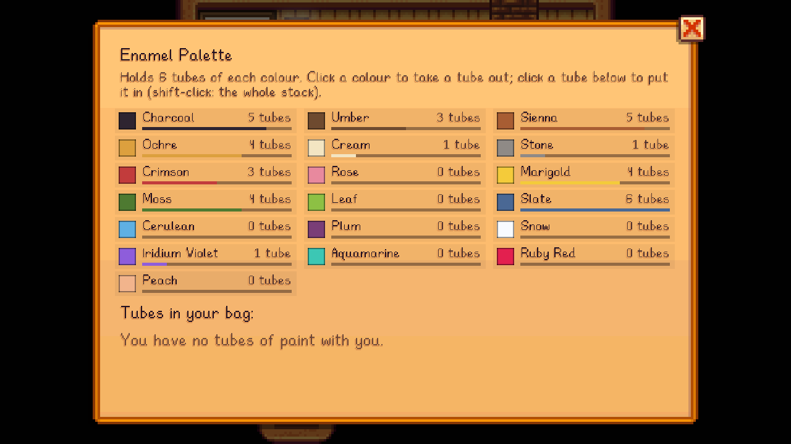

Set a Palette down and it becomes storage for paint, like a chest that only takes tubes:
- **Right-click** it to open it. Each colour shows how many tubes' worth it holds.
  - Click a colour to take a whole tube out.
  - Click a tube in your bag to put it in. Shift-click puts in the whole stack, as much as fits.
- **Hit it with any tool** to pick it up again, paint and all.
- **To paint, it has to be in your bag**, so keep a spare Palette at home as a paint store, and carry your best one.

## Every colour
Difficulty and motion describe the colour's mixing bar: how hard it is, and how the true colour moves.

| | Colour | Difficulty | Motion | How to learn it | Tube | Pigment Mill |
|---|---|---|---|---|---|---|
|  |  **Charcoal** | 15 | Smooth | Known from the start | 8g | 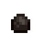 Coal x1 → 2 tubes |
|  |  **Umber** | 15 | Smooth | Known from the start | 8g |  Hardwood x1 → 2 tubes |
|  |  **Sienna** | 25 | Smooth | Buy the pigment from Sable, or pick up a tube | 12g |  Clay x1 → 2 tubes |
|  |  **Ochre** | 20 | Smooth | Known from the start | 8g | 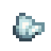 Iron Ore x1 → 2 tubes |
|  |  **Cream** | 20 | Floater | Known from the start | 8g |  Clam x1 → 2 tubes |
|  |  **Stone** | 20 | Smooth | Known from the start | 8g |  Stone x5 → 2 tubes |
|  |  **Crimson** | 35 | Mixed | Known from the start | 8g | 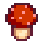 Red Mushroom x1 → 2 tubes  Hot Pepper x1 → 2 tubes |
|  |  **Rose** | 40 | Floater | Buy the pigment from Sable, or pick up a tube | 12g | 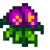 Sweet Pea x1 → 2 tubes |
|  |  **Marigold** | 35 | Mixed | Buy the pigment from Sable, or pick up a tube | 12g | 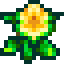 Daffodil x1 → 2 tubes |
|  |  **Moss** | 25 | Smooth | Known from the start | 8g |  Fiber x5 → 2 tubes |
|  |  **Leaf** | 35 | Mixed | Buy the pigment from Sable, or pick up a tube | 12g |  Leek x1 → 2 tubes |
|  |  **Slate** | 30 | Sinker | Known from the start | 8g | 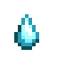 Frozen Tear x1 → 3 tubes |
|  |  **Cerulean** | 45 | Dart | Buy the pigment from Sable (Painting level 3), or pick up a tube | 20g |  Blueberry x1 → 2 tubes |
|  |  **Plum** | 45 | Sinker | Buy the pigment from Sable (Painting level 3), or pick up a tube | 20g | 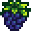 Blackberry x1 → 2 tubes |
|  |  **Snow** | 30 | Floater | Buy the pigment from Sable (Painting level 3), or pick up a tube | 20g | 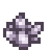 Quartz x1 → 3 tubes |
|  |  **Iridium Violet** | 75 | Dart | Rare: Sable (Painting level 8), inspiration sparks, milling, a tube | 60g |  Amethyst x1 → 3 tubes |
|  |  **Aquamarine** | 70 | Mixed | Rare: inspiration sparks, milling, a tube | 60g |  Aquamarine x1 → 3 tubes |
|  |  **Ruby Red** | 80 | Dart | Rare: inspiration sparks, milling, a tube | 60g | 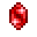 Ruby x1 → 3 tubes |
|  |  **Peach** | 25 | Smooth | Buy the pigment from Sable, or pick up a tube | 12g |  Apricot x1 → 2 tubes |

## Pigments at the art shop
Each pigment is sold once, until you know the colour.

| Pigment | Price | Needs |
|---|---|---|
|  Sienna Pigment | 120g | - |
|  Rose Pigment | 120g | - |
|  Marigold Pigment | 120g | - |
|  Leaf Pigment | 120g | - |
|  Peach Pigment | 120g | - |
|  Snow Pigment | 200g | Painting level 3 |
|  Plum Pigment | 200g | Painting level 3 |
|  Cerulean Pigment | 200g | Painting level 3 |
|  Iridium Violet Pigment | 1,500g | Painting level 8 |

## The Pigment Mill
<table align="right"><tr><th colspan="2">Pigment Mill</th></tr><tr><td colspan="2" align="center"></td></tr><tr><td><b>Sell price</b></td><td>500g</td></tr><tr><td><b>Recipe</b></td><td>Painting level 1</td></tr><tr><td><b>Ingredients</b></td><td> Stone (30)  Copper Bar (2)  Wood (10)</td></tr><tr><td><b>Art shop</b></td><td>1,000g</td></tr></table>

The Pigment Mill grinds tubes of paint overnight (10 hours) from clay, coal, stone, flowers, berries, minerals and gems: see the table above. Milling a colour you don't know gives you its tube, and the tube teaches it. The recipe unlocks at Painting level 1, or you can buy the Mill from Sable.
