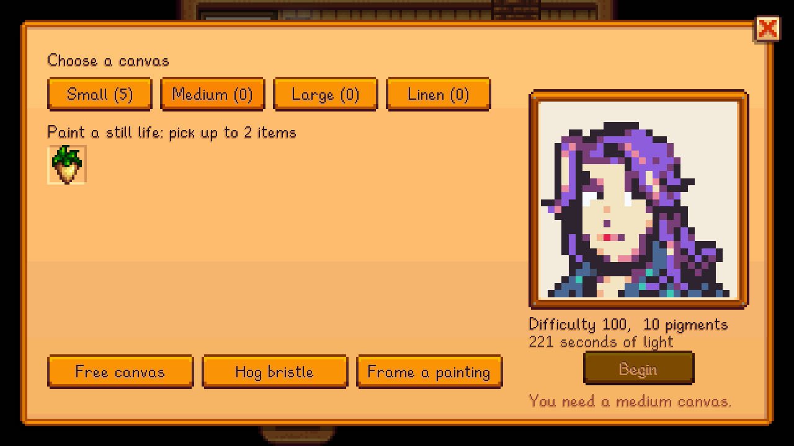
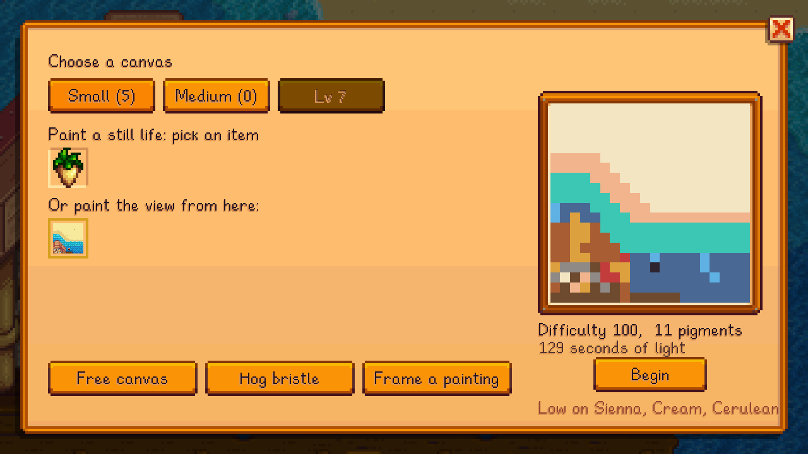

## Portraits

Once you have medium canvases (Painting level 4), friends at **4 hearts or more** will sit for a portrait. On the setup screen, their faces appear under the items in your bag: pick one.
- **Canvas:** a medium canvas paints head and shoulders; a large one, the whole portrait.
- **The reference** is their own portrait, reduced to the canvas in the colours you know.
- **Time:** a portrait takes an hour longer than a still life.
- **Value:** it sells for 1.3x, and gives 30% more Painting XP.
- **As a gift:** the sitter always loves being given theirs.
- **Commissions:** friends at 4+ hearts also post portrait requests on the [commission board](Commissions).

## Plein air: painting the view

An easel placed **outdoors** offers **the view** as a subject. The scene around the easel, mostly what's in front of it, becomes the reference. The game draws the place as it is: trees, buildings, the weather, the season.
- **Canvas:** the view fills the whole canvas, on any size.
- **Time and value:** like a portrait, it takes an hour longer and is worth 1.3x.
- **Place:** it's worth more somewhere far from the farm. The farm and town are everyday; the Woods and the Railroad less so; the Summit, the Desert and Ginger Island are rare.
- **Conditions:** rain, winter and evening (after 7pm) each raise it.
- **Seasons:** the same place in another season is a new subject in your [Painting Record](Painting-Record), so a year of views pays well.
