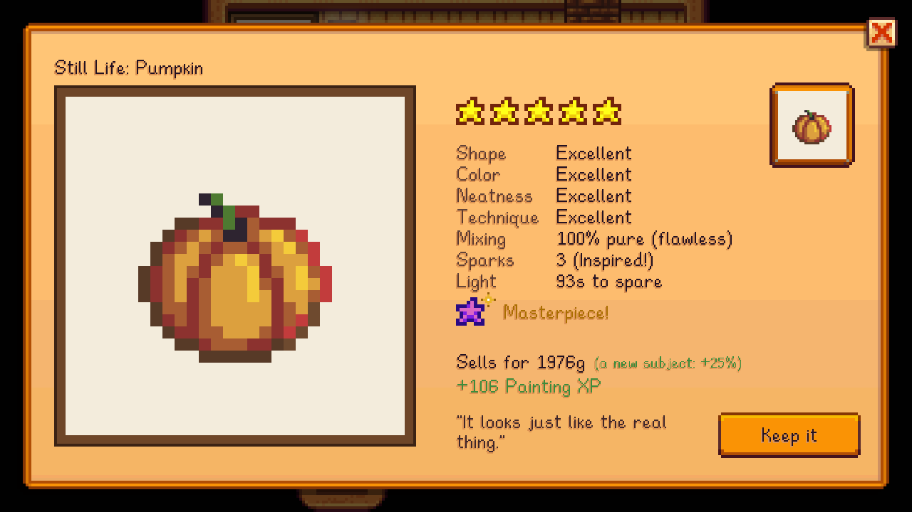

## Quality
A painting's quality comes from how well you copied the reference, plus your skill:

> **Score** = stars + 0.03 x Painting level + 0.25 if Inspired + 0.25 if every cell was mixed pure

| Score | Quality |
|---|---|
| under 2.5 | Normal |
| 2.5 | Silver |
| 3.5 | Gold |
| 4.5 | Iridium |

Your level caps the quality, however good the painting:

| Painting level | Highest quality |
|---|---|
| 1+ | Silver |
| 3+ | Gold |
| 6+ | Iridium |

The **Visionary** profession doubles what Inspired adds. A painting is Inspired when you catch 3 inspiration sparks.

### Stars
Stars (half steps, out of five) measure how close your copy is:
- **Shape:** does your painted silhouette match the reference's?
- **Color:** the right colours in the right places, with a cell's slip forgiven. Off and muddy paint counts for less.
- **Neatness:** stray paint well away from the subject.
- **Technique** (medium and large canvases): the glazes and highlights.

Where on the canvas you paint doesn't matter: every position is tried, and the best one counts.

## Masterpieces

A **Masterpiece** is above iridium. It needs all of these:
- a **linen canvas** (from Painting level 8),
- **iridium** quality,
- **five stars**,
- **Inspired**,
- on a canvas with techniques, at least 90% of its glazes and highlights right.

A Masterpiece:
- is marked with a gold star in your bag, and "A masterpiece." in its description,
- sells for 1.5x an iridium painting,
- earns half as much friendship again as a gift, and Sable has something to say about one,
- still counts as iridium quality to the game, so other mods see an iridium painting.
