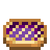
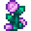

<table align="right"><tr><th colspan="2">Sable</th></tr><tr><td colspan="2" align="center"> Outfits (click to enlarge):<table><tr><td align="center"> Winter</td><td align="center"> Ginger Island</td><td align="center"> Wedding</td></tr></table></td></tr><tr><td><b>Pronouns</b></td><td>they/them</td></tr><tr><td><b>Birthday</b></td><td>Fall 9</td></tr><tr><td><b>Lives in</b></td><td>The art shop, Cindersap Forest</td></tr><tr><td><b>Marriage</b></td><td>Yes, by anyone</td></tr></table>

**Sable** runs the art supply shop in Cindersap Forest.
- **Before the valley:** a restorer at the Zuzu City Museum of Art, fixing other people's masterpieces.
- **Why they came:** the museum sent them a damaged landscape of Cindersap Forest, signed only "E.". They couldn't stop thinking about the place in it, so they quit and moved here.
- **Character:** dry, exact and quietly funny. Honest about your work, never cruel.
- **The critique:** from 2 hearts, it's Sable who writes the critique on your results screen.

> "Rain's the best light there is. Flat and honest. Nothing to hide behind."

 

## Schedule
| Day | Where |
|---|---|
| Most days | Painting by the river in the morning (spring and summer), at the counter from 10am, painting in the shop's corner in the evening |
| Wednesday | Shop closed: the museum in the morning, Evelyn and George's in the afternoon |
| Friday | Painting outside the shop in the morning, the counter until 5pm, then the Saloon |
| Sunday | The beach in the morning, the counter from 1pm |
| Rain and winter | Indoors, painting until the shop opens |

Sable goes to every festival, and dresses for the weather: a coat and scarf outdoors in winter, a linen shirt on Ginger Island.

## Gifts
| Love | Like | Dislike | Hate |
|---|---|---|---|
|  Coffee  Amethyst  Aquamarine  Ruby  Sweet Pea  Blackberry Cobbler  Fairy Rose |  Clay  Quartz  Fried Mushroom |  Hay  Sap  Joja Cola |  Slime  Sea Cucumber  Red Mushroom |

Like most villagers, Sable loves iridium paintings, and as an art lover they like any painting at all. See [Gifting Paintings](Gifting-Paintings).

## Heart events

Spoilers: when and where each event happens

| Hearts | Where and when | |
|---|---|---|
| 2 | The art shop, 6pm to 8pm (not Wednesdays) | Sable shows you the painting that brought them here |
| 4 | Cindersap Forest's riverbank, a sunny morning (Mon, Tue, Thu, Sat) | Painting side by side |
| 6 | The art shop, 6pm to 8pm | A letter from the museum, and a choice |
| 8 | Evelyn and George's house, a Wednesday afternoon | Who "E." was |
| 10 | The art shop, 6pm to 8pm, while dating | A portrait |
| 14 | The art shop, a sunny evening, once married | An exhibition |

## Romance and marriage
- **Who:** Sable can be dated and married by any farmer, with a bouquet and a Mermaid's Pendant as usual.
- **The wedding:** it uses gender-neutral vows, and Sable wears a cream suit with a teal waistcoat, a flower on the lapel and a paint-splashed pocket square.
- **Married life:** Sable moves in with their own spouse room (a studio corner) and patio (an easel), and still keeps the shop. They're at the counter from 9am to 5pm, the Saloon on Fridays, and the beach on Sunday mornings.
  - Every so often Sable paints the farm from their patio easel, and the next morning gives you the painting.
  - Some mornings they have something to say about a painting of yours you've hung in the house.

## The yard easel on Fridays
Before marriage, Sable paints at the easel in the shop's yard from 8 to 10 on Friday mornings. Talk to them there to hear what's on it; talk again and you can **stay and watch** for half an hour, for a little Painting XP (once a day).
