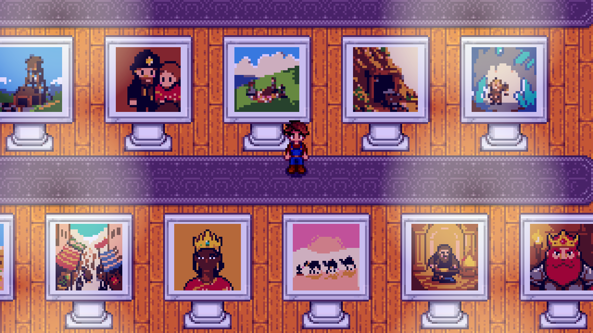

Gunther takes restored old paintings for the museum: talk to him at his counter and choose **Donate a restored painting**, then pick the painting from your bag. Framed ones count too: he keeps the painting and gives you back the empty frame. They join the museum's own collection, and **View the painting collection** at the counter shows what's there and what's missing. See [Old Paintings and Restoration](Old-Paintings-and-Restoration) for finding and restoring them.

## Rewards
| Donated | Reward |
|---|---|
| The Old Valley set | Gallery furniture, each in its own letter from Gunther: a velvet rope, a gallery bench (you can sit on it) and a marble plinth, a little pedestal you can set an item on, like a table. Sable also sells marble plinths from Painting level 6, for 2,000g |
| The Wreck set | Two Driftwood Frames ([Frames](Frames)) |
| The Miners set | Two Iron Frames |
| The Calico set | Two Sandstone Frames |
| The Dwarvish set | Two Dwarvish Frames |
| 6 paintings | A **living painting**: a mill on a river at dusk, its water shimmering and its window's lamp flickering |
| 12 paintings | **Margot's loupe**, worn as a ring: old paintings turn up half as often again |
| All 21 | A **paint-tube Junimo** statue, from Sable |

Each reward comes in the post the next morning. When a donation earns one, Gunther tells you so, and to check your mailbox.

## The Painting Wing

The day after your first donation, a new wing opens through the doorway in the exhibit hall's east wall (until then it's roped off). Inside:
- **The Old Valley** hangs framed along the back wall.
- **Every other painting** stands on its own white marble display, with its card.
- **A place is kept** for each painting still missing, so you can see what's left to find.

[Margot Pell](Margot-Pell) spends Tuesday and Thursday afternoons in the wing.
