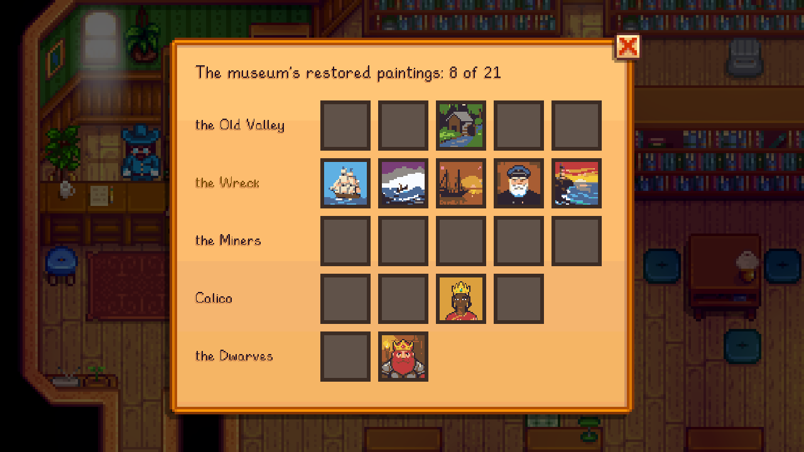

Gunther takes restored old paintings for the museum: talk to him at the counter and choose **Donate a restored painting**. They join the museum's own collection, and **View the collection** shows what's there and what's missing. See [Old Paintings and Restoration](Old-Paintings-and-Restoration) for finding and restoring them.

## Rewards
| Donated | Reward |
|---|---|
| The Old Valley set | Gallery furniture, each in its own letter from Gunther: a velvet rope, a gallery bench (you can sit on it) and a picture light to hang above a painting |
| The Wreck set | The Driftwood Frame ([Frames](Frames)) |
| The Miners set | The Iron Frame |
| The Calico set | The Sandstone Frame |
| The Dwarvish set | The Dwarvish Frame |
| 6 paintings | A **living painting**: a mill on a river at dusk, its water shimmering and its window's lamp flickering |
| 12 paintings | **Margot's loupe**, worn as a ring: old paintings turn up half as often again |
| All 21 | A **paint-tube Junimo** statue, from Sable |

## The Painting Wing

The day after your first donation, a new wing opens through the doorway in the exhibit hall's east wall (until then it's roped off). Inside:
- **The Old Valley** hangs framed along the back wall.
- **Every other painting** stands on its own white marble display, with its card.
- **A place is kept** for each painting still missing, so you can see what's left to find.

[Margot Pell](Margot-Pell) spends Tuesday and Thursday afternoons in the wing.
