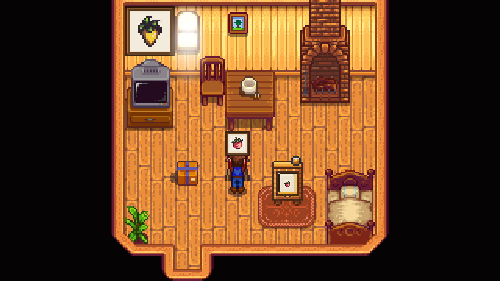

<table align="right"><tr><th colspan="2">Varnishing Cabinet</th></tr><tr><td colspan="2" align="center"></td></tr><tr><td><b>Sell price</b></td><td>800g</td></tr><tr><td><b>Recipe</b></td><td>Painting level 7</td></tr><tr><td><b>Ingredients</b></td><td> Hardwood (10)  Oak Resin (2)  Iron Bar (2)</td></tr><tr><td><b>Art shop</b></td><td>3,000g (Painting level 7)</td></tr></table>

<table align="right"><tr><th colspan="2">Varnish</th></tr><tr><td colspan="2" align="center"></td></tr><tr><td><b>Sell price</b></td><td>30g</td></tr><tr><td><b>Recipe</b></td><td>Painting level 7</td></tr><tr><td><b>Ingredients</b></td><td> Oak Resin (1)  Oil (1)</td></tr><tr><td><b>Art shop</b></td><td>120g (Painting level 7)</td></tr></table>

Varnish a painting and it's worth more: the painter's answer to a cask. From Painting level 7, you can craft both the **Varnishing Cabinet** and **Varnish**, or buy them from Sable.

## Using the cabinet
1. Place the cabinet, indoors or out.
2. With a tin of **Varnish** in your bag, use the cabinet while holding a painting. The painting goes in and the tin is used up. You can see it through the glass.
3. Wait. The varnish cures over the weeks:

| In the cabinet | Finish | Value |
|---|---|---|
| 7 days | Satin | 1.1x |
| 14 days | Gloss | 1.2x |
| 28 days | Gallery | 1.3x |

4. **Right-click** the cabinet to see how it's coming along. Like a cask, it gives the painting up by itself only once it's fully cured. It shows the "ready" bubble then.
5. **To take it out sooner**, hit the cabinet with any tool. You get the finish it has reached. Before 7 days there's no finish, and the varnish is wasted.

A varnished painting:
- has a faint gloss on its picture,
- shows its finish in its description,
- keeps the finish when framed.

Each painting can be varnished once.
